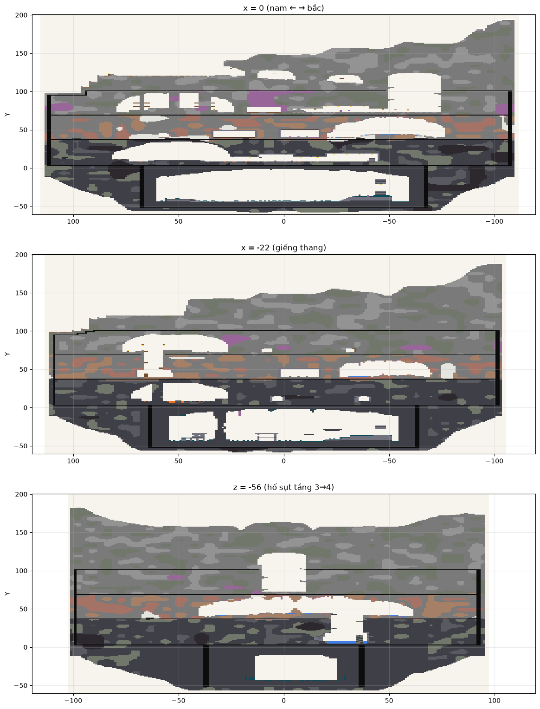
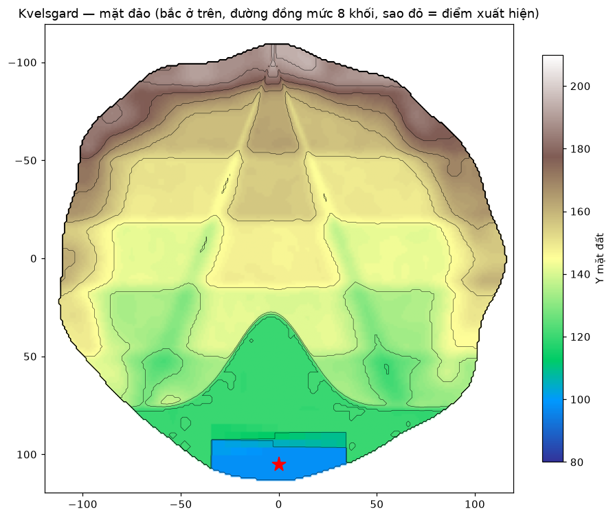
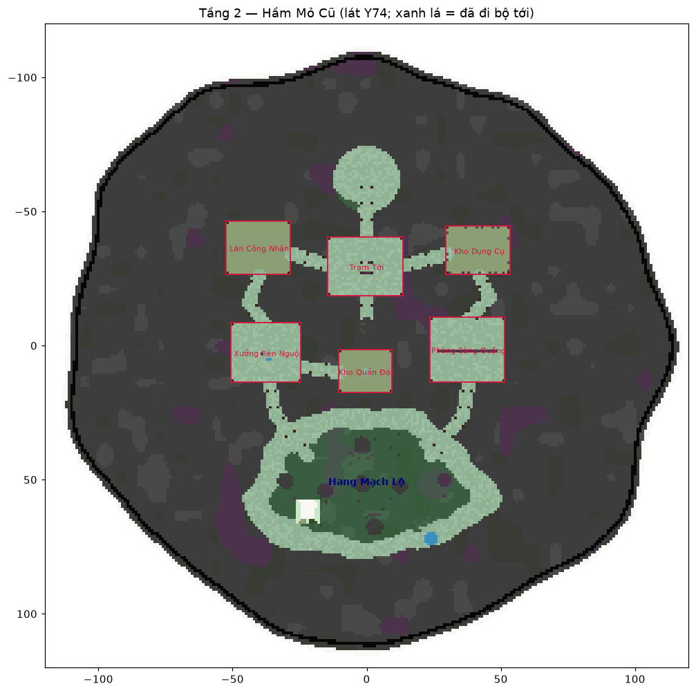
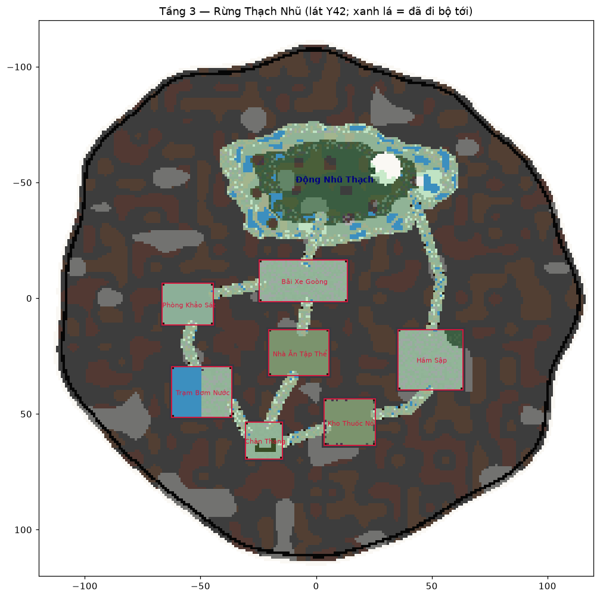
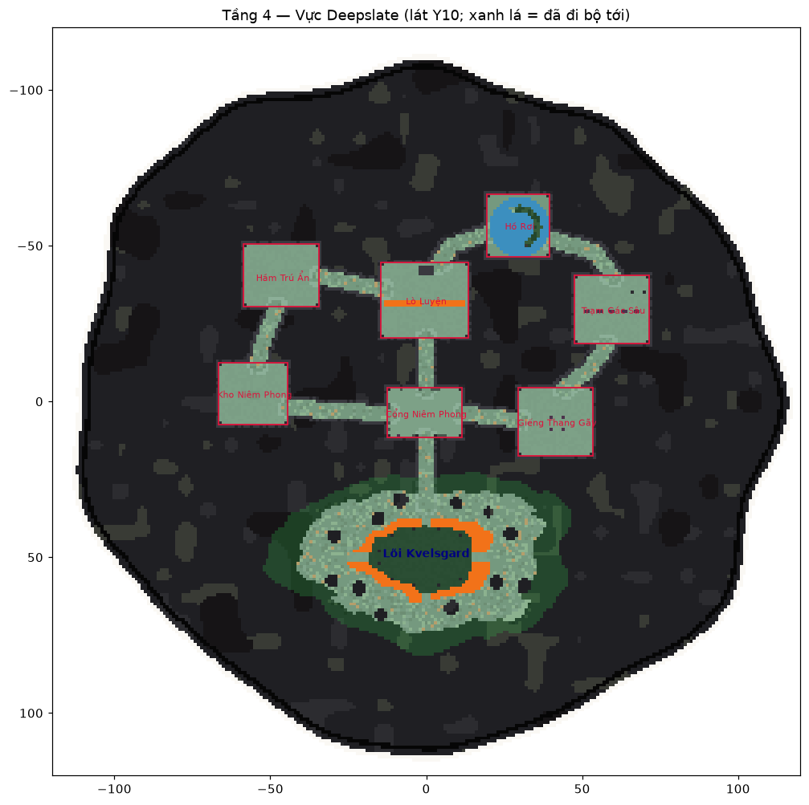
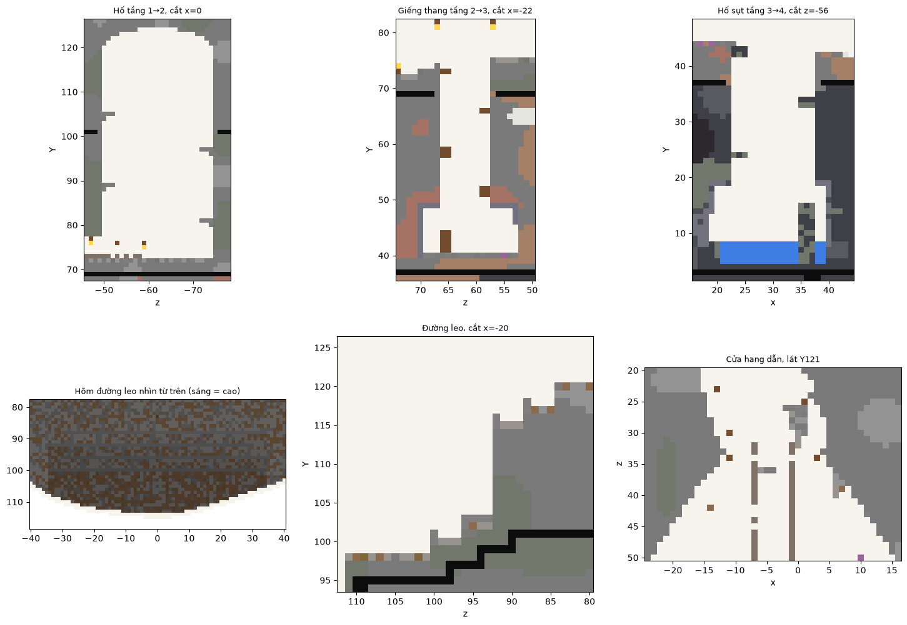
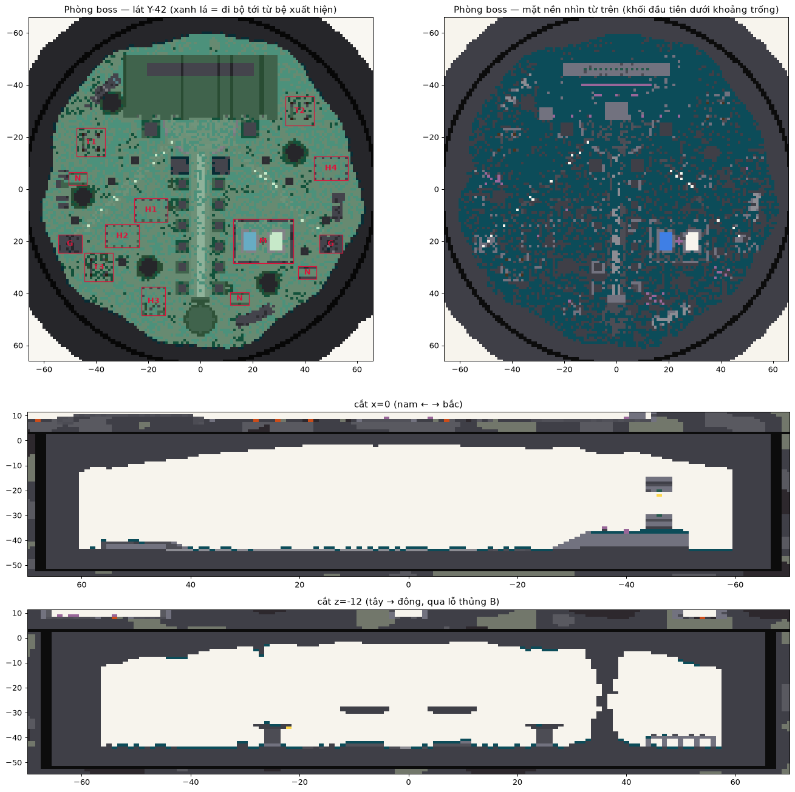

# Kvelsgard — mỏ quặng bỏ hoang trong núi

Dungeon đảo nổi cho server **When the Dungeon Arise**. Toàn bộ khối đảo sinh bằng Python ra 5 file schematic (cắt theo dải Y), dán bằng FAWE.



## Tóm tắt
| Phần | Mô tả | Y |
|---|---|---|
| Barrier | tường tròn r119.5–122, sàn, nắp | −64 → 319 |
| Layer 1 | thềm xuất hiện (mép nam) → đường leo chữ chi → bãi mỏ hình chuông → hang dẫn 5 khúc → hố r12 có gờ xoắn | thềm 98, bãi 120, đỉnh núi 197 |
| Layer 2 · Hầm Mỏ Cũ | mỏ gỗ chống, 6 phòng, Hang Mạch Lộ (buồng-cột, 3 bậc, giàn giáo, thác mảnh), giếng thang chữ chi | sàn 72 |
| Layer 3 · Rừng Thạch Nhũ | hang đá vôi ẩm, 7 phòng, Động Nhũ Thạch (cột thạch nhũ, bậc đá vôi có hồ nông), hố sụt có thác | sàn 40 |
| Layer 4 · Vực Deepslate | deepslate, dung nham, đèn soul, 7 phòng, Lõi Kvelsgard (đài đá, hào dung nham, 4 cầu, cột bazan) | sàn 8 |
| Tấm bedrock | dưới L1 (≤101, bậc thang), 69, 37, 3 + vách đứng sát mép đảo + vỏ phòng boss (đáy −52, vách trụ r66.5–68); chỉ hở ở hố, giếng, hố sụt | |
| Layer 5 · Cổ Thành Câm Lặng | phòng boss deep dark: hang R60, đại lộ 12 cột vừa + 4 cột lớn → sảnh bán nguyệt → bệ 3 bậc → cổng 41×21×5 có vành reinforced; tháp canh, nhà hai tầng, điện mộ, trại nến, tường thành, cột nấm; sculk phủ nền; vào bằng teleport | nền −44, vòm −2 |

## Bắt đầu nhanh
```bash
pip install -r requirements.txt
python3 scripts/generate_world.py            # output/kvelsgard_l1..l5.schem, layout.json, report.txt, images/
python3 scripts/generate_world_commands.py   # commands/
```
Trong game: [docs/03_build_runbook.md](docs/03_build_runbook.md).

## Tài liệu
| File | Nội dung |
|---|---|
| [CLAUDE.md](CLAUDE.md) | bất biến, quy trình kiểm tra |
| [docs/01_design.md](docs/01_design.md) | luồng người chơi, từng khu, chỗ đã đổi so với bản thiết kế |
| [docs/02_parameters.md](docs/02_parameters.md) | cao độ, tọa độ cố định |
| [docs/03_build_runbook.md](docs/03_build_runbook.md) | thứ tự dán, kiểm tra trong game, dữ liệu cho plugin |
| [docs/04_status_and_todo.md](docs/04_status_and_todo.md) | trạng thái, việc còn dở |
| [output/report.txt](output/report.txt) | kết quả kiểm tra lần sinh gần nhất |
| [output/layout.json](output/layout.json) | tọa độ spawn, phòng, hang, lối xuống cho plugin |

## Sơ đồ
| | |
|---|---|
|  |  |
|  |  |




